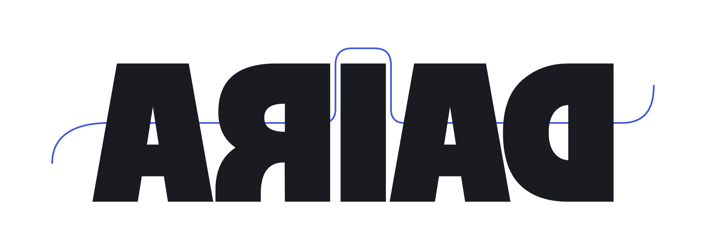

<p align="center">
  <a href="assets/brand/ariad-ember-motion.svg#gh-dark-mode-only">
    
  </a>
  <a href="assets/brand/ariad-paper-motion.svg#gh-light-mode-only">
    
  </a>
</p>

ARIAD is an experimental, embeddable tunneling engine written in Rust.
It provides an HTTP/2 CONNECT binding and a reference server. Runtime bindings
use shared codecs, resource accounting, and policy primitives. The sans-I/O
`Core` is a separate model of session and stream transitions.

Version **0.5.1** is experimental. Public APIs and wire formats may change.
The engine exposes TCP streams and UDP associations; the integrating application
provides routing, system DNS policy, and any GUI or TUN driver.

## Run the local example

From a source checkout, use the Rust toolchain pinned in
[rust-toolchain.toml](rust-toolchain.toml), Cargo, and the target's linker and C
build tools. [Cargo.toml](Cargo.toml) declares the workspace's edition and MSRV.
Run the commands below from the repository root. The syntax works in PowerShell
and POSIX shells.

```sh
cargo run -p ariad-h2-connect
```

The example creates a temporary TLS identity, starts a loopback H2 listener, and
exchanges 256 KiB with an in-memory echo target through the public Rust API.
It checks the returned bytes and shuts down the engine. Its success message is
`h2_engine_echo=ok bytes=262144`.

## Connect to a configured proxy

This example needs a reachable proxy, a trusted CA certificate in DER format,
and a TCP echo destination allowed by the proxy's egress policy. Set
`ARIAD_CREDENTIAL_HEX` to the proxy credential: exactly
[`Credential::HEX_LEN`](crates/core/src/auth.rs) hexadecimal digits.
Replace every angle-bracket placeholder below, including the credential. This
variant uses PowerShell:

```powershell
$env:ARIAD_CREDENTIAL_HEX = '<credential-hex>'
cargo run -p ariad-client-stream -- '<endpoint-ip:port>' '<tls-name>' '<ca.der>' '<echo-destination>'
```

The endpoint argument must be an IP address and port. The TLS name must match
the certificate. The example verifies a 256 KiB echo and prints
`h2_echo=ok bytes=262144` on success. It closes its streams and sessions before
shutting down the engine.

The reference server requires an explicit destination allow list. It authenticates
CONNECT before destination DNS or egress and connects to a checked address.
Server command-line options are defined in
[main.rs](crates/server/src/main.rs); the configuration schema is in
[config.rs](crates/server/src/config.rs).

## Integration and limits

The [native embedding guide](crates/ffi/README.md) covers the C ABI and C++ owners.
[Python](bindings/python/README.md) and [Go](bindings/go/README.md) document their
wrappers. These bindings and [mobile examples](bindings/mobile/) are source
integrations, not released packages; foreign-language linkage and mobile execution
remain unverified.

The [embed crate](crates/embed/src/lib.rs) reexports the public Rust types.
`PinnedH2Builder` configures a fixed H2 endpoint, host limits, socket hooks and
shared resource pools without network I/O. The caller owns its Tokio runtime.
The [Rust engine exports](crates/engine/src/lib.rs) also provide bootstrap DNS,
multiple endpoints, trust policies and optional bindings. Engine accessors expose
configuration, resource counters and the current network epoch.

`Stream::into_split` provides independent read and write halves for concurrent
I/O. `write_all` and `read_exact` use one absolute deadline for partial progress.
Finish writes with `end_write` while continuing reads to EOF.
`Association::into_split` provides separate datagram send and receive halves.

- H2 uses TLS 1.3 and reliable CONNECT-UDP capsules. It rejects requests that
  require unreliable delivery. The reference daemon rejects CONNECT-UDP unless
  the host supplies a socket that prevents IP fragmentation and a payload limit
  through `run_with_udp_connector`.
- Optional `tls-boring` and `h3` features provide native TLS and experimental
  QUIC/H3. `H3ServerSession` owns one UDP socket for one peer; the daemon has no
  multi-client H3 listener. Outgoing QUIC UDP payloads are capped at 1200 bytes.
  The host must configure the OS to prevent fragmentation; the default socket
  factory does not verify that setting.
- quiche 0.30 logs header values at TRACE. H3 requires a compile-time `log` maximum
  of INFO or lower and otherwise returns `UnsupportedCapability` before peer I/O.
  `h3-log-info` selects that policy across the dependency graph. A runtime logger
  filter alone does not meet the requirement.
- Memory quotas cover reserved application allocations, not native TLS/QUIC
  memory, kernel buffers, or process RSS. Rust hosts can share `EngineResources`
  across engines. Default constructors and the C ABI use per-engine pools.
- The C ABI exposes H2 streams and capsule associations, without H3. Calls are
  synchronous with bounded payloads. One worker per engine advances transport
  tasks and timers between calls. Independent I/O directions can run concurrently;
  direction or bookkeeping contention can return `ARIAD_ERROR_BUSY`. Engine destroy
  invalidates handles before network waits under its deadline. `ARIAD_FORCED` can
  defer runtime cleanup until admitted calls return.
- ECH and 0-RTT are unavailable. Required ECH fails with `UnsupportedCapability`.
  Failed tunnels do not fall back to direct connections or replay application data.

Native linkage, H3 interoperability, mobile integration, and field performance
remain unverified. The engine does not claim censorship resistance or production
readiness. Build and test procedures are in [CONTRIBUTING.md](CONTRIBUTING.md);
[quality-tool configuration](.config/ariad/README.md) lists additional checks.

## License

Copyright © 2026 Eluvane. The licensor is Eluvane; licensing requests go to [keiko1337@proton.me](mailto:keiko1337@proton.me). The official repository is [eluvane/ariad](https://github.com/eluvane/ariad).

Ariad is covered by the [Mother of Licenses 1.0](LICENSE) (`LicenseRef-MoL-1.0`). There is no earlier published release. Third-party dependencies and any separately licensed material retain their own licenses and notices.

MoL permits royalty-free use, including commercial use of unmodified code or Authorized Builds inside your own products. Private modifications and production patches are permitted for your own internal use, provided the modified code is not distributed, published, made available to third parties, or used to create a standalone or competing product or provide Project-as-a-Service. The upstream contribution workflow in Section 6 remains permitted. Other publication or distribution of modified versions, independent forks, resale of Ariad itself, and hosting Ariad itself as a service require written permission. Ariad under MoL is source-available, not OSI-approved open source.

## Contributing

Read [CONTRIBUTING.md](CONTRIBUTING.md) and Sections 9 and 10 of the license before
submitting changes. The contribution and patent terms apply upon submission;
no separate acceptance statement or PR checkbox is required by default.
