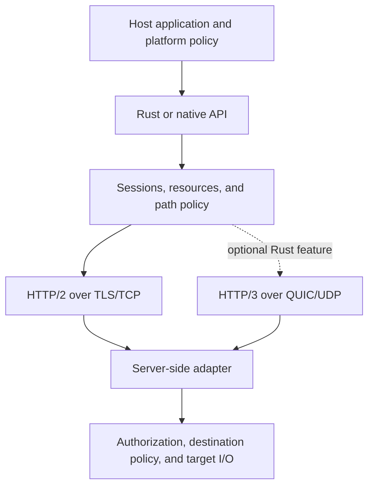

# ARIAD concept and design

ARIAD is an experimental tunneling engine for applications that need TCP streams
and UDP associations through a verified proxy. The host application owns its
runtime, device routing, system DNS policy, and user interface.

**Status:** proposed project direction with an implementation baseline. The
[public API](../crates/engine/src/lib.rs) and wire formats remain experimental.
The current implementation section describes repository code. Later sections
define design targets and acceptance criteria; they do not establish platform
support, performance, or resistance to network filtering.

Use the [README](../README.md) for runnable examples, the
[native guide](../crates/ffi/README.md) for C ABI contracts, and
[Release workflow](../.github/workflows/release.yml) for publication. Those procedures and
[contribution rules](../CONTRIBUTING.md) remain the command references.

## Contents

- [Current implementation](#current-implementation)
- [1. Executive summary](#1-executive-summary)
- [2. Central research question](#2-central-research-question)
- [3. Hypothesis and negative results](#3-hypothesis-and-negative-results)
- [4. Scope](#4-scope)
- [5. Design principles](#5-design-principles)
- [6. Architecture](#6-architecture)
- [7. Protocol semantics](#7-protocol-semantics)
- [8. Trust and authorization](#8-trust-and-authorization)
- [9. Resources and concurrency](#9-resources-and-concurrency)
- [10. Network policy and traffic profiles](#10-network-policy-and-traffic-profiles)
- [11. Embedding](#11-embedding)
- [12. Reference server and distribution](#12-reference-server-and-distribution)
- [13. Verification and measurements](#13-verification-and-measurements)
- [14. Development stages](#14-development-stages)
- [15. Risks and open decisions](#15-risks-and-open-decisions)

## Current implementation

Runtime bindings share codecs, resource accounting, and policy primitives from
`ariad-core`. The sans-I/O `Core` is a separate transition model; runtime sessions
are not driven by that model. Model tests therefore do not establish socket,
TLS, authentication, or transport behavior.

| Area | Repository baseline | Boundary |
| --- | --- | --- |
| H2 | TLS 1.3, CONNECT streams, reliable CONNECT-UDP capsules | Unreliable delivery requests fail |
| H3 | Optional quiche/BoringSSL Rust adapter | Experimental; the reference daemon has no multi-client H3 listener |
| Rust embedding | Fixed H2 builder, host services, shared resource pools, split I/O | The caller owns Tokio and platform policy |
| Native embedding | Synchronous H2 C ABI; C++, Python, and Go consumers | No H3, socket-protection hook, or network-change entry point |
| Mobile | Swift consumer and JNI/Kotlin metadata sources | Android and iOS remain unsupported in target metadata |
| ECH and early data | ECH and application 0-RTT are unavailable | Required ECH fails before peer I/O |

The H3 server adapter owns one UDP socket for one peer. Outgoing QUIC UDP payloads
are capped at 1200 bytes. The host must prevent IP fragmentation; the default
socket factory does not verify that setting. H3 also requires a compile-time
`log` maximum of INFO or lower because the pinned quiche implementation can log
header values at TRACE. `h3-log-info` selects the required policy; a runtime filter
alone is insufficient.

Source presence and configured CI jobs are distinct from successful target
validation. The [feature manifest](../crates/engine/Cargo.toml),
[target metadata](../crates/core/src/support.rs), tests, and actual release
artifacts define separate parts of that evidence.

## 1. Executive summary

The project aims to make tunneling a library capability. An application supplies
trusted endpoints and host policy, opens a session, and uses streams or
associations without acquiring another application's routing, configuration,
or service-management model.

TLS and standard HTTP transports provide channel protection and transport
delivery. ARIAD owns admission, authorization boundaries, flow lifetimes,
resource accounting, and path selection. A thin reference server makes those
contracts usable outside a custom host.

The first useful result is a complete H2 path: verified connection, authorized
target open, bidirectional transfer, defined partial progress, cancellation,
and teardown. Additional transports and traffic profiles must preserve that
contract. A localhost echo demonstrates one path; deployment readiness requires
failure, resource, interoperability, and platform evidence.

## 2. Central research question

Can a bounded tunneling engine preserve one stream and datagram contract across
H2, H3, and native integrations while reducing the cost of embedding, without
weakening peer verification, hiding delivery changes, or moving unbounded work
into the host runtime?

The question has three practical parts. Integrators need a small interface with
explicit ownership. Maintainers need shared semantics that survive transport
changes. Operators need measurable behavior under failed paths, slow targets,
overload, and network changes.

Success depends on usable integrations and reproducible measurements. The number
of wrappers, transports, or configuration options does not answer the question.

## 3. Hypothesis and negative results

### Main hypothesis

Shared semantic primitives, bounded adapters, and explicit host services can
reduce duplicated lifecycle and policy code. Applications can retain control of
routing and trust while reusing the engine's transport implementation.

Evaluate the hypothesis on a frozen set of integrations and workloads. Count
adapter code, required native dependencies, ownership rules, configuration
steps, debugging effort, runtime cost, and behavior after failures.

The null hypothesis is that adapter work, native packaging, debugging, and
runtime obligations erase the savings from a shared engine. Include those costs
in the comparison.

### Negative results

The hypothesis fails for a tested scope when:

- A transport needs a different public meaning for EOF, cancellation, or UDP
  delivery that cannot be expressed through negotiated capabilities.
- An embedding requires hidden global state, an incompatible native library
  graph, or platform hooks that cannot run before dialing.
- Resource limits leave ordinary malformed input or slow consumers with
  unbounded retained state.
- Maintaining several wrappers costs more than the shared interface saves.
- The fast path changes trust, data integrity, or progress semantics.
- A simpler adapter provides the same tested behavior at lower total cost.

A negative result should narrow the interface, transport scope, or supported
targets. It should not be hidden by relaxing the invariant under test.

## 4. Scope

ARIAD's data model is byte streams and destination-bound UDP associations.
Client and server libraries, the reference daemon, codecs, wire vectors,
and integration boundaries are inside the project.

GUI, TUI, TUN drivers, OS routes, system DNS settings, kill switches, subscriptions,
account services, service installation, and complete mobile applications belong
to the host or deployment. A host using TUN needs its own packet-to-flow adapter
and policy for unsupported traffic.

A UDP association is not a layer-3 tunnel. It does not promise arbitrary IP
protocols, ICMP, source-IP preservation, or transparent packet routing.
The project also makes no general anonymity or browser-indistinguishability claim.

## 5. Design principles

### Trust before availability

An unreachable tunnel must not enable a direct target connection. A faster path
cannot override certificate identity, credential scope, required capabilities,
or egress policy. Overload reduces admission rather than verification.

### Semantics before optimization

EOF, reset, truncation, cancellation, and deadline expiry have different meanings.
Accepted write progress must remain observable. Transport fallback cannot replay
application bytes or silently change UDP delivery.

### Host control without hidden work

The host supplies endpoint, resolver, socket, and trust policy at explicit
boundaries. The library must not install a global logger or signal handler,
start mandatory update services, or persist credentials without a storage contract.

### Bounds before scaling

Limit bytes, objects, tasks, and lifetimes together. More workers, queues, caches,
or connection shards need a measured bottleneck and a preserved portable path.
A resource counter is meaningful only for the allocations it actually covers.

### One owner for each contract

Keep wire encoding in codecs and vectors, ABI definitions in their declared
sources, and usage rules with the public interface. Share implementations where
the behavior is identical. Keep transport differences explicit when they change
delivery or lifecycle.

## 6. Architecture

The host-facing API separates policy and ownership from transport mechanics:

The H3 path requires optional Rust features and host-owned peer handling. The
reference daemon provides H2. The native API has a different runtime boundary
from Rust and exposes H2 only.

| Component | Responsibility | Boundary |
| --- | --- | --- |
| [Core](../crates/core/src/lib.rs) | Codecs, transition models, budgets, and policy primitives | No socket or runtime ownership |
| [Engine](../crates/engine/src/lib.rs) | Transport adapters and session/flow lifecycle | Uses configured host services and Tokio |
| [Embed](../crates/embed/src/lib.rs) | A fixed H2 builder and public Rust entry point | Constructs configuration without network I/O |
| [Server](../crates/server/src/lib.rs) | Reference listener, configuration, and checked egress | Operator policy controls destinations |
| [FFI](../crates/ffi/README.md) | Numeric handles, synchronous operations, and native ownership | Callers obey the C memory and lifetime contract |

The model and runtime should agree on observable outcomes. Reusing a codec or
budget helper does not prove that agreement. Changes affecting both need model
coverage and real transport tests.

Rust, Cargo, Tokio, h2, Rustls, and the optional native TLS/QUIC graph are selected
by the workspace manifests and lockfile. BoringSSL remains an upstream native
dependency. Its internal objects must not become public ABI types. A different
QUIC driver or TLS backend is an alternative only when a concrete embedding or
transport requirement fails; the change needs compatibility and lifecycle evidence.

## 7. Protocol semantics

### Version boundaries

Protocol semantics, H2/H3 bindings, traffic profiles, configuration schema,
Rust API, and C ABI have separate compatibility concerns. Package version changes
do not replace wire negotiation. Profile revisions cannot hide a new meaning
for EOF or datagram delivery.

The [version definitions](../crates/core/src/version.rs),
[C header](../crates/ffi/include/ariad.h), codecs, and
[wire vectors](../tests/vectors/) own literal values and implemented encoding.
Experimental negotiation headers remain explicit extensions, not claims of
registration or general proxy interoperability.

### Streams

One application TCP flow maps to one request stream. A verified proxy session
and a successful destination open are separate results. Authorization and target
connection must complete before the server acknowledges the open.

Reads, writes, flushes, and half-close report their defined local progress.
A successful write does not prove remote application processing. Ending writes
can leave reading active until clean EOF. Reset and truncated transport closure
must not be normalized into success.

After partial I/O, cancellation or timeout can leave accepted bytes and an
uncertain external outcome. Neither a new session nor H3-to-H2 fallback permits
automatic replay. Arbitrary destination protocols do not provide an engine-level
exactly-once guarantee.

### Datagram associations

An association binds one destination and request context. The negotiated mode
distinguishes `UnreliableNative`, `ReliableEncapsulation`, and `Unsupported`.
H2 capsule delivery is reliable encapsulation. A request requiring unreliable
delivery fails when the peer or binding cannot provide it.

A send handles a whole message or reports a defined error/drop result. Preserve
empty messages and association isolation. Late packets, stale generations, and
a closed context cannot deliver into a replacement association.

The payload limit depends on the binding, encapsulation overhead, and path.
An API ceiling is not proof of unfragmented delivery. Oversized messages fail
explicitly. Fragmentation, multiple destinations, and multipath are separate
extensions with their own bounds and negotiation.

### Network changes

QUIC address migration, TLS resumption, and application flow resumption are
different mechanisms. A restarted peer or replacement transport does not recover
the old flow's state.

New work can use a new admissible path. Existing flows drain, continue where
permitted, or terminate with a reason. Buffered bytes do not create transparent
resumption.

## 8. Trust and authorization

### Threat model

Include passive traffic observation, packet loss/delay/injection, active endpoint
probing, invalid clients, authorized resource abuse, malicious destinations,
stolen credentials, and concurrent API calls within the documented memory contract.

A compromised host, compromised exit operator, or global traffic correlation
needs a separate security model. The exit can observe destination metadata and
application plaintext beyond the tunnel's protected segment.

### Peer identity

Use upstream TLS cryptography. Complete configured chain, name, validity, and
pin checks before sending credentials or application data. Pinning adds a
constraint; it must not follow a handshake that disabled verification.

The host owns its trust store and credential scope. A valid certificate for a
different service does not authorize moving a token there. Resumption caches,
future early-data support, and ECH need their own identity and replay rules.
Required but unavailable capabilities fail explicitly.

### Authorization and egress

Authorization applies to each target open. Missing credentials, backend errors,
and expired decisions deny tunneling before destination DNS or dialing.
A successful request does not authorize later requests on the same connection.

Resolve destination names on the egress side under an explicit allow policy.
Validate every candidate address and connect to the checked address without
another hidden lookup. Normalize mapped addresses and reject ambiguous syntax.
Apply the same rules to failover and UDP replies.

Private/local ranges, metadata services, and the server's own listeners require
deliberate operator permission. Allow lists and address checks constrain direct
egress; they cannot prove that an allowed destination is not another relay.

Credential rotation and revocation need a defined active-flow policy. Bound any
authorization cache. Logs, metrics, errors, and public endpoint metadata must
exclude tokens and application payloads. Unauthorized probes must not receive
principal-specific diagnostics.

## 9. Resources and concurrency

### Accounting

`BudgetLimits::lab_small()` supplies laboratory defaults, not universal deployment
settings. The [budget implementation](../crates/core/src/budget.rs) owns those
values and validation rules. Avoid copying the numeric defaults into another
configuration reference.

| Resource | Required bound |
| --- | --- |
| Sessions and pending handshakes | Admission count and lifetime |
| Flow and association buffers | Retained capacity, including empty-message overhead |
| Headers and control work | Encoded/decoded sizes, object count, and processing work |
| Destination DNS and dialing | Concurrent operations, answer count, and parent deadline |
| Transport tasks and queues | Admission count, retained bytes, and terminal cleanup |
| Caches and diagnostics | Entries, expiry, cardinality, and retained output |

Application reservations are distinct from native TLS/QUIC memory, kernel
buffers, and process RSS. Measure those independently. Rust hosts can share
`EngineResources` across engines; default constructors and the C ABI use
per-engine pools.

### Ownership and backpressure

One owner releases each permit, socket, timer, and buffer. Partial setup failure
must release everything admitted before it. A small buffer slice can retain a
large backing allocation; charge the retained capacity until that allocation ends.

A slow consumer must not block connection control, timers, or close indefinitely.
H2 receive credit and H3 datagram queues need explicit retention limits. Spawning
a task for each message does not remove a queue bound.

Independent read/write and send/receive directions may progress concurrently.
Do not hold a global lock across network waits. Additional scheduling machinery
needs evidence that ordinary bounded tasks cannot meet the workload.

### Deadlines and teardown

Use one absolute deadline for a logical operation. Child stages cannot extend it
through partial progress, another candidate, or another transport. Socket
preparation hooks are synchronous; an async timer cannot interrupt a blocked hook.

Cancellation cannot undo bytes already accepted or a target connection already
created. Preserve the primary operation error while reporting cleanup outcomes.
Graceful drain has a finite budget, followed by forced cleanup when necessary.

The Rust shutdown API can await transport cleanup after the supplied deadline
expires. A forced result and invalidated handles are distinct from confirmed
completion. Native callers must keep the library loaded while calls or deferred
runtime cleanup remain active.

## 10. Network policy and traffic profiles

### Path selection

The host supplies trusted endpoints, identity names, addresses, and credential
scope. Endpoint IDs and live IP addresses are not cryptographic identity.

Filter candidates by trust and required capabilities before ranking reachability.
Bound candidates, parallel attempts, total time, and retries. Race channel setup,
not target opens with possible external side effects. Close losing channels.

Distinguish endpoint DNS failure, handshake failure, peer identity failure,
authentication denial, target failure, and resource rejection. A denied token
must not be retried against unrelated endpoints. A target outage must not be
treated as evidence that every tunnel path failed.

Network epochs scope reachability evidence and stale completions. They do not
reset trust, revocation, or process-wide resource limits.

### Bootstrap and configuration

Separate endpoint bootstrap DNS from destination DNS. A host can supply a fixed
address while retaining the certificate hostname. Endpoint resolution must not
depend on the tunnel being established. A prohibited plaintext fallback remains
prohibited after a resolver timeout.

Local trusted configuration is sufficient for the initial engine. Online discovery
and signed profile distribution are optional future work. Any metadata system
needs bounded parsing, trusted roles, expiry, rollback protection, atomic
application, and a defined offline policy. A signature cannot authorize weaker
TLS, a new credential scope, executable profile code, or direct target fallback.

### Traffic profiles

Start with standard transport behavior. Treat padding, fingerprint adaptation,
ECH, cover traffic, and special filtering techniques as separate experiments.
Sharing a TLS library does not establish browser resemblance.

A proposed traffic profile contains bounded data and installed capabilities,
not scripts, arbitrary library URLs, or trust bypasses. Add padding only through
a negotiated mechanism the peer can remove; never insert it into the destination's
raw byte stream. Bound extra bytes, overhead ratio, delay, burst size, and lifetime.

Evaluate profiles against a stated observer. IP, timing, sizes, volume, and
termination behavior remain relevant even when application data is encrypted.
Required ECH must be verified end to end before claiming private-name protection.

### Restriction experiments

Use controlled cases for DNS interference, UDP blocking, address blocking,
handshake rejection, post-handshake byte/time cutoffs, residual blocking state,
active probing, interception, loss, MTU blackholes, and suspend/resume.

A timeout does not identify censorship. Compare an owned control service and an
independent path. Record date, network, version, workload, and failure stage.
Results on one path do not become universal timeout constants or country-wide
support claims.

## 11. Embedding

### Entry points

| Host | Entry point | Scope |
| --- | --- | --- |
| Rust | [ariad-embed](../crates/embed/src/lib.rs) | Fixed H2 builder and public engine types |
| Rust with host services | [ariad-engine](../crates/engine/src/lib.rs) | Resolver, sockets, trust policy, resources, and optional transports |
| C | [Native guide](../crates/ffi/README.md) | Synchronous H2 streams and capsule associations |
| C++17 | [ariad.hpp](../crates/ffi/include/ariad.hpp) | Move-only owners around the C ABI |
| Python | [ctypes wrapper](../bindings/python/README.md) | Explicit shared-library loading and synchronous operations |
| Go | [cgo wrapper](../bindings/go/README.md) | Native linkage and synchronous operations |
| Swift | [Consumer source](../bindings/mobile/apple/PinnedH2Session.swift) | H2 C ABI consumer; mobile execution is unverified |
| Kotlin/JNI | [Metadata source](../bindings/mobile/android/AriadMetadata.kt) | Metadata queries, not a network client |

The Rust [configured client](../examples/client-stream/src/main.rs) and
[local H2 example](../examples/h2-connect/src/main.rs) demonstrate the public
entry point. Commands and prerequisites remain in the root README.

### Rust lifecycle

`PinnedH2Builder` constructs an engine and endpoint policy without resolving DNS,
opening sockets, or creating a runtime. The address chooses the route; the TLS
hostname chooses certificate identity. The caller drives Tokio with I/O and time
enabled and retains it through awaited shutdown.

Reuse sessions when appropriate. Use split directions for simultaneous I/O.
Keep one deadline across partial operations. `write_all` reports local acceptance;
`read_exact` can leave a changed output prefix on failure. Finish writes with
`end_write` and continue reading when the application protocol requires EOF.

Close sessions and shut down the engine on success and failure. Inspect the
shutdown report instead of treating object drop as completed network cleanup.

### Native ownership

Check ABI version and required exports before creating an engine. Numeric
handles do not validate arbitrary pointers; callers must supply valid memory
and retain borrowed buffers until each call returns. Native embedding is not
a sandbox for hostile code in the same process.

Calls are synchronous and run outside UI threads and tasks that cannot block.
One worker per C engine advances transport work between calls. Direction or
bookkeeping contention can return `ARIAD_ERROR_BUSY`; retain ownership and
follow the operation's retry and destruction contract.

Shutdown and destruction invalidate child handles at defined boundaries.
`ARIAD_FORCED` can leave deferred cleanup while admitted calls finish. Preserve
the loaded library until cleanup is established; the ABI has no deferred-cleanup
completion query. Use the native guide for exact status and ownership rules.

### Platform policy

Rust `HostServices` and `SocketFactory` provide preparation before connect or
bind. Hooks may run concurrently and have no main-thread affinity. A protection
failure must stop dialing. The engine owns borrowed sockets; hosts must not close
them or retain raw handles beyond the hook.

The C ABI has no socket-protection callback or network-change setter. An Android
VPN integration needs a Rust host adapter or a separately reviewed bridge before
its upstream sockets can be excluded from tunnel routes. Wrapping calls in JNI
does not supply that missing hook.

Rust hosts report a newer `NetworkEpoch` through `Engine::on_network_change`.
The call cancels pending connects, stops new opens on old sessions, and starts
background drain. It does not await that drain or roll back an advanced epoch
after an error. A C host must tear down and recreate its engine with refreshed
endpoint information.

Apple device and simulator builds, Android ABI/API-level selection, native
linkage, packaging, routing, and lifecycle require target-specific validation.
Mobile example sources and desktop archives do not establish mobile support.

## 12. Reference server and distribution

### Server boundary

The reference daemon loads validated configuration, serves H2, authenticates
requests, and connects only to allowed destinations. The
[server implementation](../crates/server/src/listen.rs) owns admission, destination
resolution, address checks, and drain behavior.

The default daemon rejects CONNECT-UDP unless the host provides
`run_with_udp_connector` with a connected UDP socket that prevents fragmentation
and a payload bound. Library-level association support does not make the default
daemon an unrestricted UDP proxy.

Operators supply identities, credentials, allowed destinations, and process
resource policy. An account database, web panel, and executable updater are not
requirements of the initial server.

### Deployment topology

Direct TLS termination, L4 passthrough, and external TLS termination have different
trust boundaries. An external terminator can see bearer tokens and channel
plaintext and must be trusted accordingly.

Verify CONNECT behavior, streaming, buffering, datagram support, idle limits,
and cancellation for the chosen intermediary. H3 at an edge does not establish
end-to-end H3 or native datagram delivery. Protect the backend independently;
untrusted forwarded headers do not establish client identity.

### Release and compatibility

The manual [Release workflow](../.github/workflows/release.yml) prepares a tagged
source snapshot, native H2 archives, and checksums. Release descriptions list
downloads and link to the changelog. GitHub provides source archives for the
release tag. The target matrix is in
[release tooling](../tools/release.py); the workflow defines publication and retry
behavior.

Each release is published as a regular release marked `Latest`. Its title is the
version tag, such as `v0.5.1`.

A configured target is a build goal. A published artifact and its executed checks
supply evidence for that specific build. API stability, wire interoperability,
mobile support, and operational readiness require separate acceptance.

Before a transport or native dependency update, inspect the effective feature
graph, symbols, required targets, and upstream changes. Exercise negative trust,
authorization, lifecycle, and resource cases. Keep trace and benchmark changes
scoped to the tested versions.

Use and distribution are governed by [LICENSE](../LICENSE). Dependencies retain
their own terms. A smaller dependency list does not justify replacing reviewed
cryptographic implementations.

## 13. Verification and measurements

### Invariants

| Area | Required result | Representative failure case |
| --- | --- | --- |
| Peer trust | No credentials or payload before verified identity | Wrong name, chain, validity, or pin |
| Authorization | No destination DNS or socket before admission | Missing token, denial, backend timeout |
| Routing | Tunnel failure does not enable direct access | All permitted endpoints fail |
| Stream progress | No replay, silent loss, or false EOF | Short I/O, cancellation, reset, truncation |
| Datagram isolation | Mode, size, and context remain explicit | Loss, late replies, closure, stale generation |
| Resources | Admission and retained state stay bounded | Tiny-message floods, slow receivers, exhausted credit |
| Cleanup | Outcomes distinguish drain, forced close, and unfinished work | Concurrent shutdown, pending calls, blocked hooks |
| Path policy | Attempts are bounded and scoped | Blackholes, flapping networks, synchronized retries |

These are target acceptance properties. The test sources define individual
scenarios; passing one layer does not establish every transport or platform.

### Test layers

[Core tests](../crates/core/tests/) cover codecs, policy, budgets, transitions,
and negative inputs. [Engine tests](../crates/engine/tests/) cover transport
sessions and TLS behavior. The [C consumer](../crates/ffi/tests/consumer.c)
exercises the native interface. Tooling tests protect ABI generation and release
preparation.

Extend those with fault injection, independent decoding, interoperability,
native sanitizers where applicable, and controlled network impairments.
Use real components for the behavior being claimed. A mock authorizer cannot
establish transport teardown, and a model cannot establish certificate validation.

### Performance method

Compare identical workloads, trust rules, delivery modes, and correctness
checks. Freeze versions, lockfiles, target, build mode, hardware, OS, transport,
budgets, concurrency, payloads, RTT, loss, and bottleneck placement.

Measure operation success, connect/open/first-byte latency, useful goodput,
p50/p95/p99 latency, worst stalls, CPU per useful transfer, steady/peak RSS,
charged bytes, tasks, descriptors, startup, and binary size. Mobile evaluation
also needs wakeups, idle traffic, battery cost, and lifecycle behavior.

Count timeouts and failed attempts alongside latency. Verify received bytes.
Separate protocol/padding traffic from useful payload and local acceptance
from destination success. Alternate comparison order, repeat runs, and report
variation. No language or architecture choice alone establishes a speed advantage.

### Filtering and field evidence

Capture at the defined observer boundary. Decrypted HTTP traces and an ordinary
on-path observer have different information. Hold out endpoint, time, and version
when evaluating classifiers and report false positives on ordinary traffic.

Use owned endpoints and consenting participants. Collect the minimum data needed
for the claim, with a retention policy. A control connection narrows possible
causes; it does not prove a filtering mechanism. Publish a scoped result with
remaining failures rather than a general resistance claim.

## 14. Development stages

The stages below are acceptance milestones, not a completed-work inventory or
release schedule. Existing source can contribute evidence without satisfying
an entire milestone.

| Stage | Useful result | Acceptance focus |
| --- | --- | --- |
| A. Embedding baseline | A complete Rust H2 client/server path | Verified identity, authorized open, progress, cancellation, teardown |
| B. Bounded operation | Predictable behavior under malformed input and overload | Admission, retained memory, control progress, and cleanup |
| C. Transport parity | H2 capsules and H3 streams/datagrams with explicit capabilities | Delivery mode, size, isolation, no replay or hidden downgrade |
| D. Host integration | Native consumers and platform-specific host adapters | ABI ownership, linkage, socket preparation, runtime lifecycle |
| E. Difficult networks | Bounded path adaptation and measured profiles | Failure scope, epochs, bootstrap, trust, and dated path evidence |
| F. Optimization | Reproducible improvements on representative workloads | Equivalent semantics, CPU/RSS/latency, fairness, and recovery |
| G. Stable contract | Versioned compatibility and supported release dimensions | Independent review, update process, interoperability, and support policy |

H3 feature code and native wrappers already exist. Their remaining work is
validation and completion of the relevant contracts, not the creation of every
component from scratch. Multipath, fragmentation, advanced shaping, and new
transports remain separate experiments until a measured need justifies them.

## 15. Risks and open decisions

| Risk or question | Evidence needed | Response if the design fails |
| --- | --- | --- |
| Model/runtime divergence | Matching failure outcomes in model and transport tests | Narrow the claimed shared contract and fix its owning layer |
| Native TLS linkage | Effective graph, symbols, host-library coexistence, target builds | Repair the graph or replace the isolated adapter |
| Multi-client H3 server | Bounded connection routing, ownership, authentication, and drain | Retain the single-peer scope until a listener meets the contract |
| ECH | Verified bootstrap, acceptance/retry, identity, and supported adapters | Keep required mode unavailable; do not downgrade silently |
| Mobile integration | Native packaging, socket protection, lifecycle, device tests | Keep the target unsupported and use explicit host adapters |
| Traffic-profile benefit | Matched captures, held-out tests, bounded overhead | Remove ineffective shaping and preserve standard transport behavior |
| Performance | Repeated end-to-end measurements with equivalent semantics | Optimize measured costs or reduce scope |
| Online metadata | Demonstrated need and a reviewed freshness/rollback model | Retain host-managed local configuration |

Decisions should record the failed requirement, considered alternatives, evidence,
compatibility consequences, and recovery path. Add a subsystem when it resolves
that requirement with a testable contract. Keep unsupported capabilities visible
rather than replacing missing evidence with broader promises.
